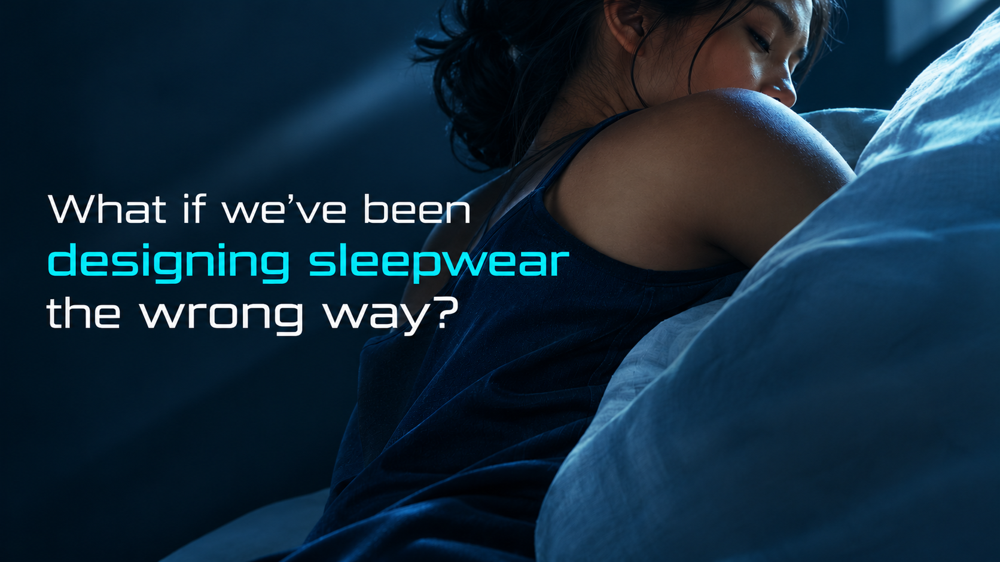

# Nocturnal thermal comfort of sleepwear in hot-humid climates



A data-driven look at how clothing insulation, bedding, room temperature, humidity and air movement relate to feeling too warm in
hot-humid homes, built only from two open datasets. Everything is reproducible from a single Colab notebook.

> Read the limitations below before using any number. The comfort votes come from awake people in buildings, not from people asleep.

## Research questions

1. How do comfort votes change with clothing insulation (clo), temperature and relative humidity in hot-humid, residential, low-activity settings?
2. How much insulation do sleeping sets give, by posture (thermal manikin)?
3. What is the highest sleepwear-plus-cover insulation that stays comfortable at 29 degC / 85% RH, with and without a fan?
4. Which factors matter most?

## Datasets (both CC BY 4.0)

| Dataset | Source | Licence |
|---|---|---|
| ASHRAE Global Thermal Comfort Database II v2.1 | https://zenodo.org/records/4993952 (DOI 10.6078/D1F671) | CC BY 4.0 |
| Heat balance of sleeping sets (Newton thermal manikin), Brno University of Technology. Data manager Jan Bajer, principal investigator Jan Fišer | https://zenodo.org/records/20179324 (DOI 10.5281/zenodo.20179324) | CC BY 4.0 |

Raw files are downloaded at run time by `src/download.py` into `data/raw/` and are not stored in this repository. If you reuse the results,
please credit both datasets.

## Quick start (Google Colab)

1. Open `notebooks/analysis.ipynb` in Google Colab (a CPU runtime is enough).
2. Choose Runtime, then Run all. It takes about 10 minutes. If the first cell asks for a runtime restart after installing packages, restart and Run all again.
3. The last cell packages the outputs into `stage4_outputs.zip` and downloads it.

The notebook is self-contained: it writes the contents of `src/` itself, downloads both datasets from Zenodo, and runs every stage in order.

To run locally with Python 3.13: `pip install -r requirements.txt`, then run the notebook top to bottom. Random seeds are fixed (`SEED = 42` in `src/config.py`).
Small differences in the third decimal can appear between library versions, mainly in cross-validation metrics.

## Pipeline

| Stage | What it does | Main code |
|---|---|---|
| 1. Inspect | Download, profile both tables, find candidate columns | `src/download.py`, `src/inspect_data.py` |
| 2. Clean and explore | Filter to hot-humid, multifamily housing, met up to 1.3; parse the manikin tables; exploratory figures | `src/clean.py`, `src/manikin.py`, `src/explore.py` |
| 3. Original label (negative result) | Predict "comfortable" (vote from -1 to +1) against PMV | `src/models.py` |
| 4. Main analysis | Warm-side discomfort target, model comparison, SHAP, scenarios, summary | `src/models.py`, `src/explain.py`, `src/scenarios.py`, `src/stage4.py`, `src/report.py` |

Column names live in one place only (`COLUMN_MAP` in `src/config.py`). `tools/build_notebook.py` rebuilds the notebook from `src/`.

## Key decisions

- Hot-humid climate: an explicit list of climate classes (`HOT_HUMID_CLASSES` in `src/config.py`), not a text match.
- Residential means multifamily housing, and low activity means met up to 1.3.
- Main target: warm-side discomfort, defined as a rounded sensation vote of +1 or more. The first target ("comfortable") could not be predicted, and that result is kept in `results/neg_comfort_label_*.csv`.
- Validation: building-grouped 5-fold cross-validation, plus a leave-one-contributor-out check. Intervals come from resampling buildings.
- Baseline: PMV, by two methods (ISO 7730 and ASHRAE 55 with cooling effect), using pythermalcomfort.
- Scenarios combine garment clo with the manikin cover increment (the cover set minus the "Without cover" set, per posture). "Stays comfortable" means predicted
  warm-side discomfort of 20% or less for the models, and PMV below +0.5 for theory.

## Headline results

All numbers come from the files in `results/`. The full write-up with every table is `results/summary.md`.

- **Data:** 109,033 raw votes were filtered to 2,307 votes from 164 buildings, 4 contributors, 3 countries (India, Malaysia, China). There are no Sri Lankan records. 27.1% of votes are warm-side discomfort. The row count after each filter is in `results/filter_log.csv`.
- **Models against PMV** (ROC AUC, building-grouped 5-fold, 95% interval over buildings): PMV ISO 0.761 [0.724, 0.793]; PMV ASHRAE 0.763 [0.724, 0.800];
  linear logistic 0.780 [0.742, 0.817]; quadratic logistic 0.772 [0.733, 0.810]; XGBoost 0.774 [0.731, 0.813]. Leaving one contributor out: linear logistic 0.777, XGBoost 0.745. The intervals overlap,
  so the models rank about as well as PMV. Linear logistic is the primary model.
- **What matters most** (share of SHAP importance, XGBoost): air temperature 64%, air speed 23%, humidity 7%, clothing insulation 3%, metabolic rate 2%. Shuffling air temperature costs about 0.2 AUC on held-out contributors. Shuffling clo changes AUC by about 0.003 at most.
  The data barely identify a clothing effect.
- **Manikin:** a cover adds 0.45 to 0.88 clo, while lying on the side instead of the back lowers the total by 0.05 to 0.13 clo.
- **Highest comfortable total clo at 29 degC / 85% RH:**

| Basis | No fan (0.09 m/s) | Fan (0.40 m/s) |
|---|---|---|
| PMV, ISO 7730 | 0.58 | 0.83 |
| PMV, ASHRAE 55 | 0.58 | 0.94 |
| Linear logistic model | 1.12 (95% interval 0.37 to 2.50) | 1.94 (95% interval 1.00 to 2.50), beyond the training clo range |

The PMV limits come from theory, not from fitting these votes. The model intervals are very wide, which is what a near-zero clothing effect looks like. Treat the PMV numbers as working
design values and the model numbers as supporting evidence only.

## Repository layout

```
notebooks/analysis.ipynb     full run, from download to results
src/                         config, download, inspection, cleaning, manikin parsing, models, SHAP, scenarios, reporting
tools/build_notebook.py      rebuilds the notebook from src/
data/processed/              cleaned ASHRAE subset (ashrae_clean.csv.gz), regenerated by the notebook
results/                     all result tables (CSV/JSON) and summary.md
figures/                     PNG (300 dpi) and SVG figures
requirements.txt             pinned versions
```

Key result files: `model_comparison_warm.csv`, `model_comparison_sensation.csv`, `shap_global_importance.csv`, `permutation_importance_loco.csv`,
`logistic_coefficients.csv`, `manikin_total_clo.csv`, `manikin_cover_increments.csv`, `scenario_highest_clo_by_conditions.csv`,
`scenario_bedding_sets_29C_85RH.csv`, `design_garment_budget.csv`, `key_numbers.json`.

## Limitations

- ASHRAE votes come from awake people in buildings, so they only stand in for sleep comfort.
- Neither dataset has skin-temperature or sweat data, so fabric moisture handling cannot be assessed.
- The manikin data cover only the back (supine) and left side, and four bedding set-ups. The garments are not described.
- The data are observational. Findings are associations, not causes: fans are used when it is hot, and cooler homes have more clothing.
- Only 4 contributors in 3 countries, none in Sri Lanka. Only 11 to 29 votes reach the clo values of the manikin totals, so the highest combined totals are an extension of the data.
- Garment clo is clothing only, while manikin totals include bedding. Adding the cover increment to garment clo assumes the two add up.
- PMV was run outside its ISO 7730 validity range for many rows, and mean radiant temperature was often missing (air temperature was used instead).
- With the original "comfortable" label, the models did not beat a constant predictor, and performance did not hold across contributors.

## Reproducibility notes

- Every number in `results/summary.md` is generated from the CSV files by `src/report.py`. Nothing numeric is typed by hand.
- The notebook was tested end to end on synthetic mock data. Stages 1 to 4 were run on the real Zenodo data on Colab, and the real-data results in `results/` come from that run.
